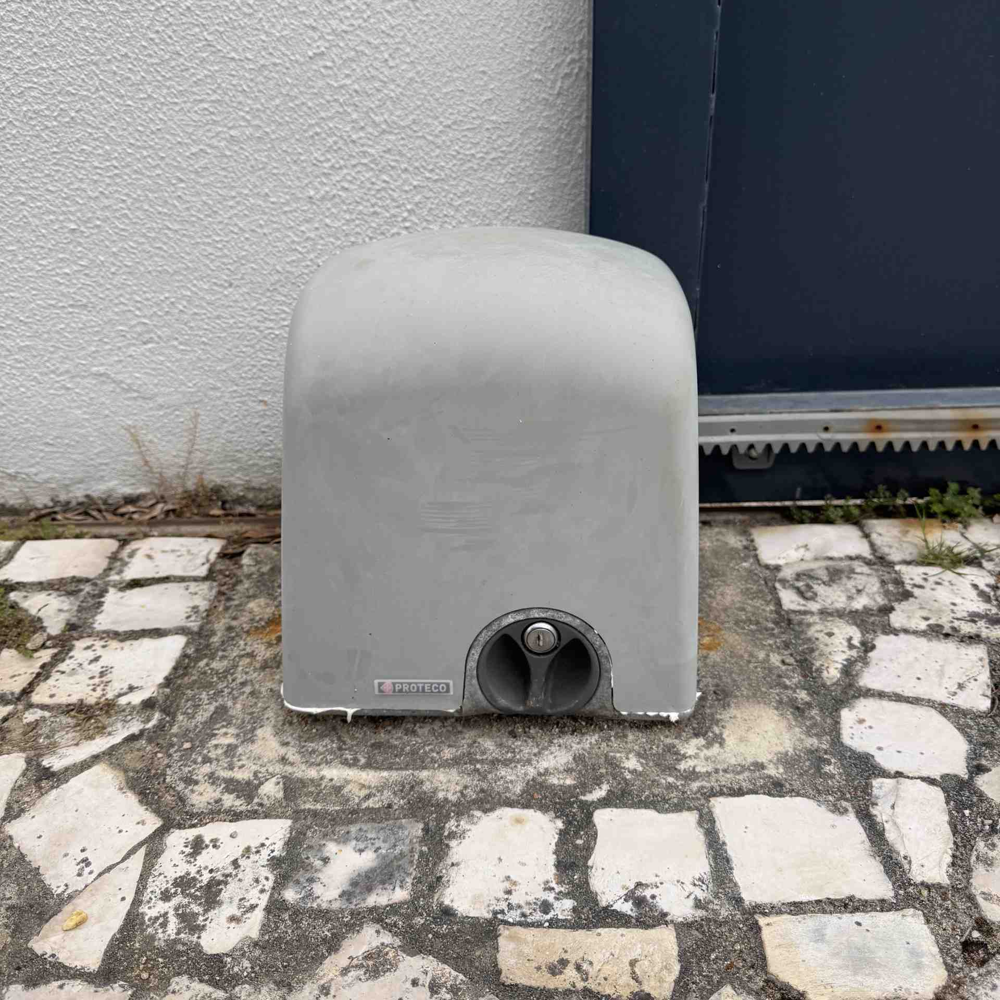
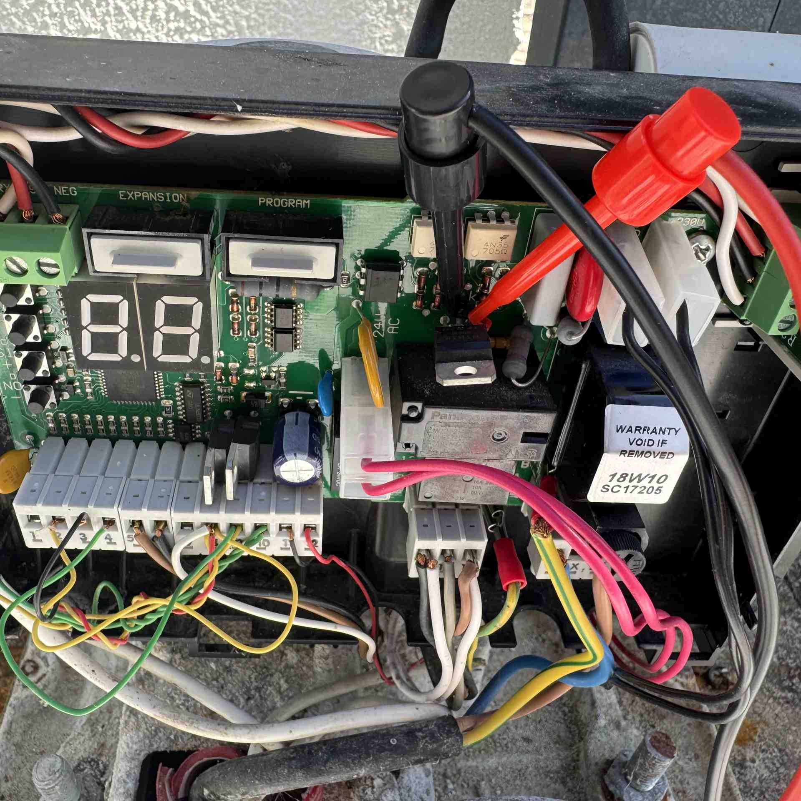
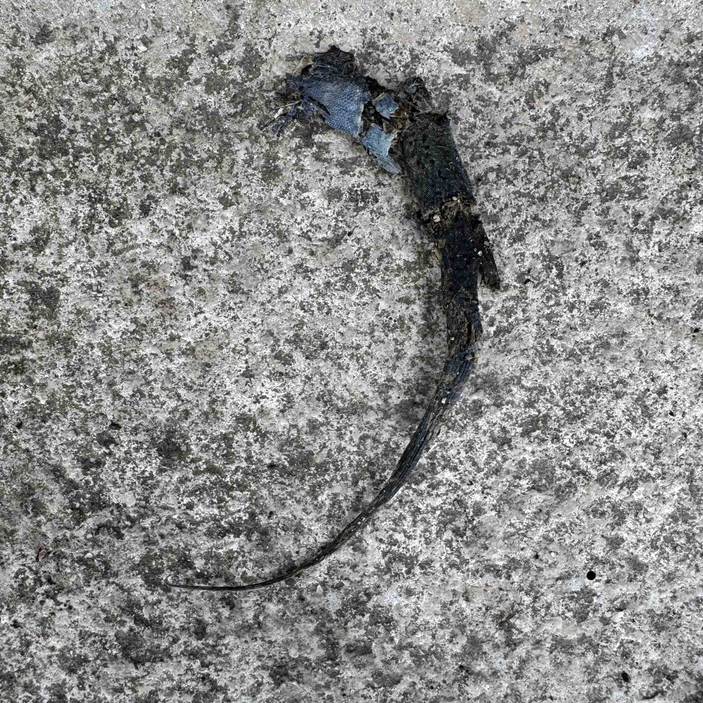
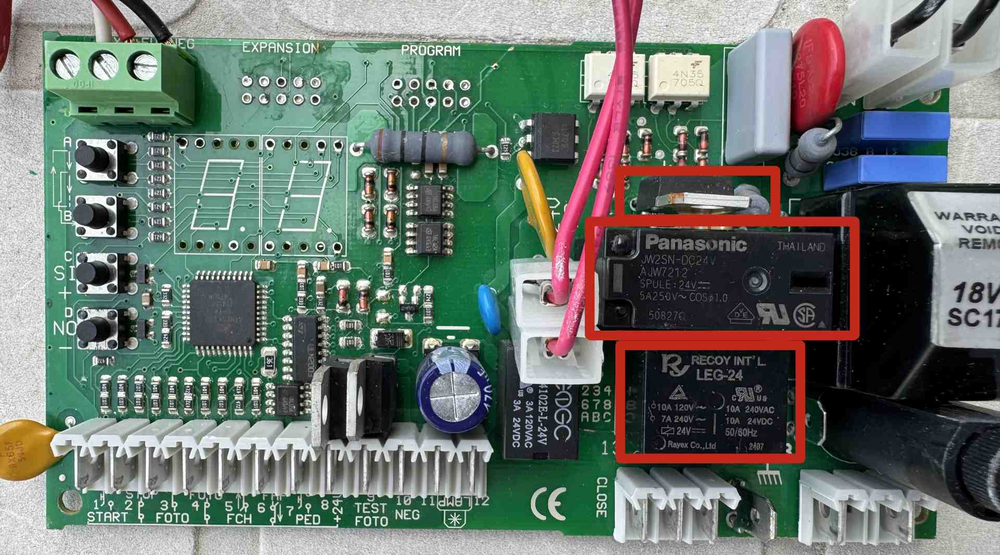
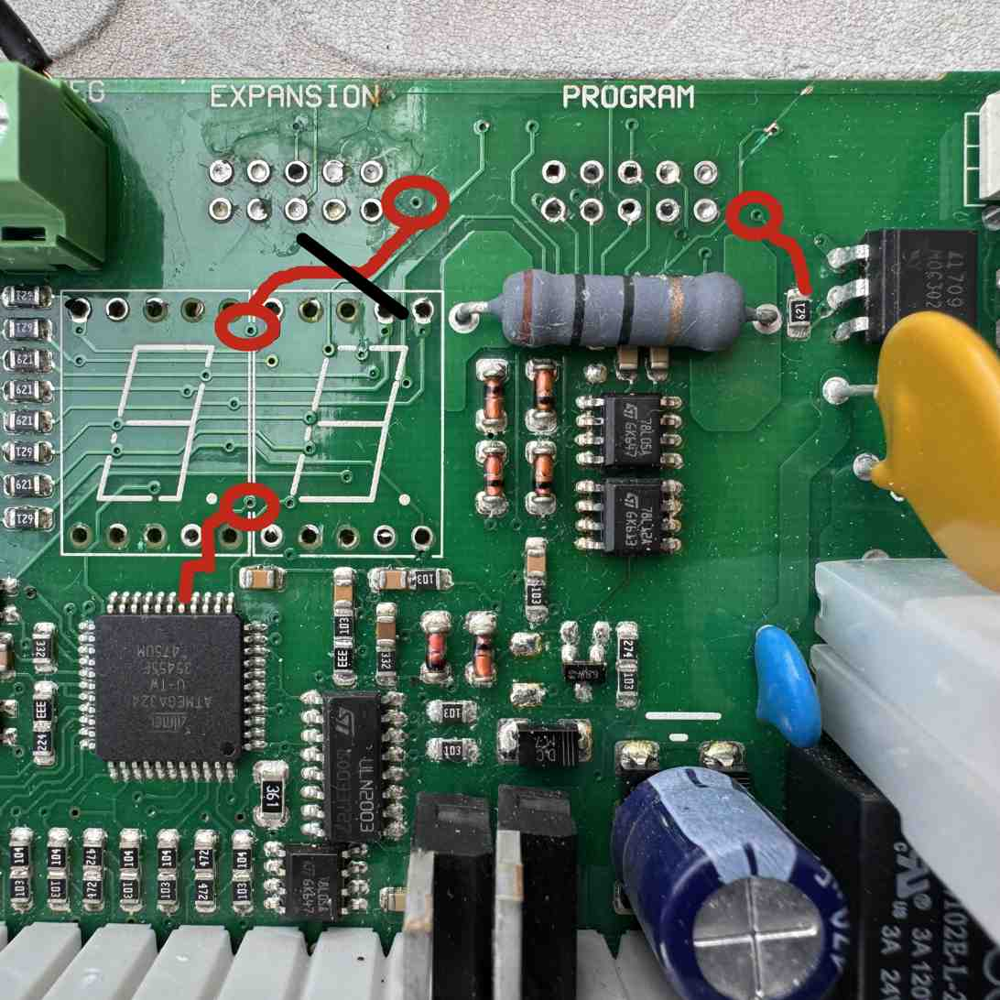
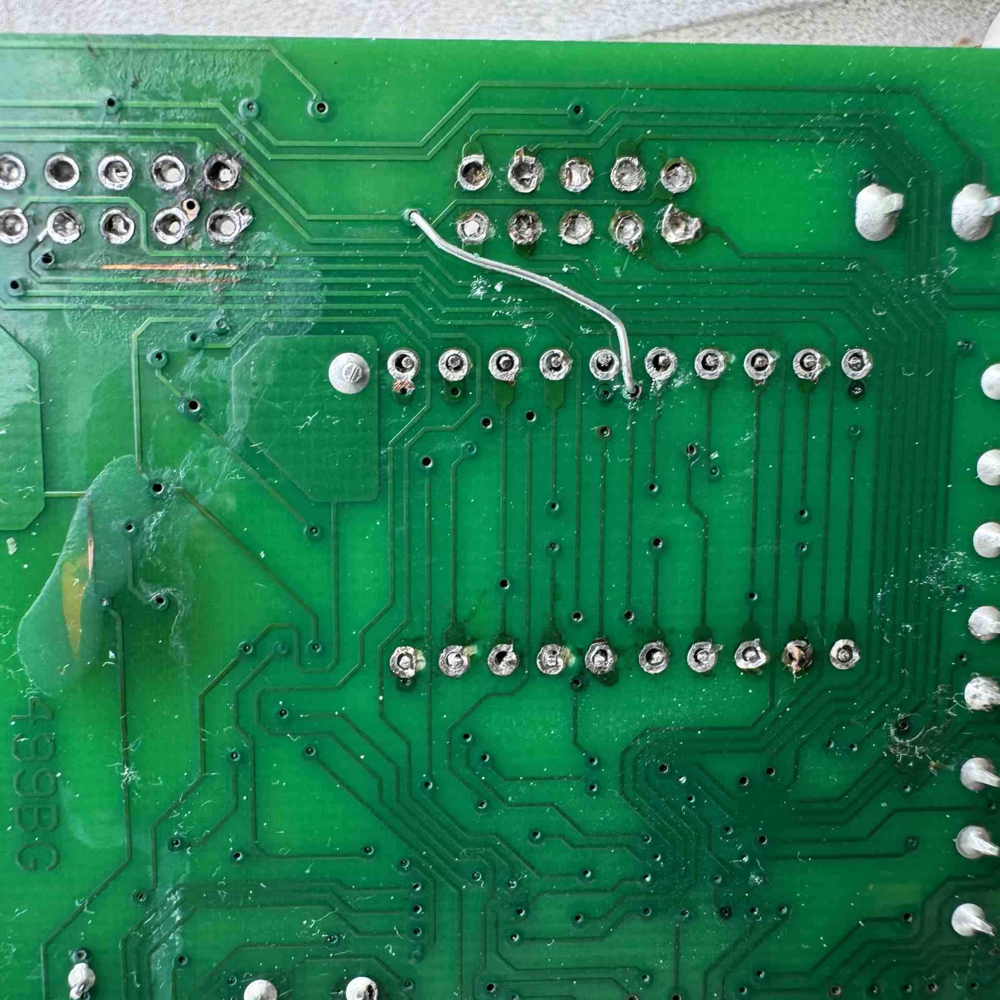
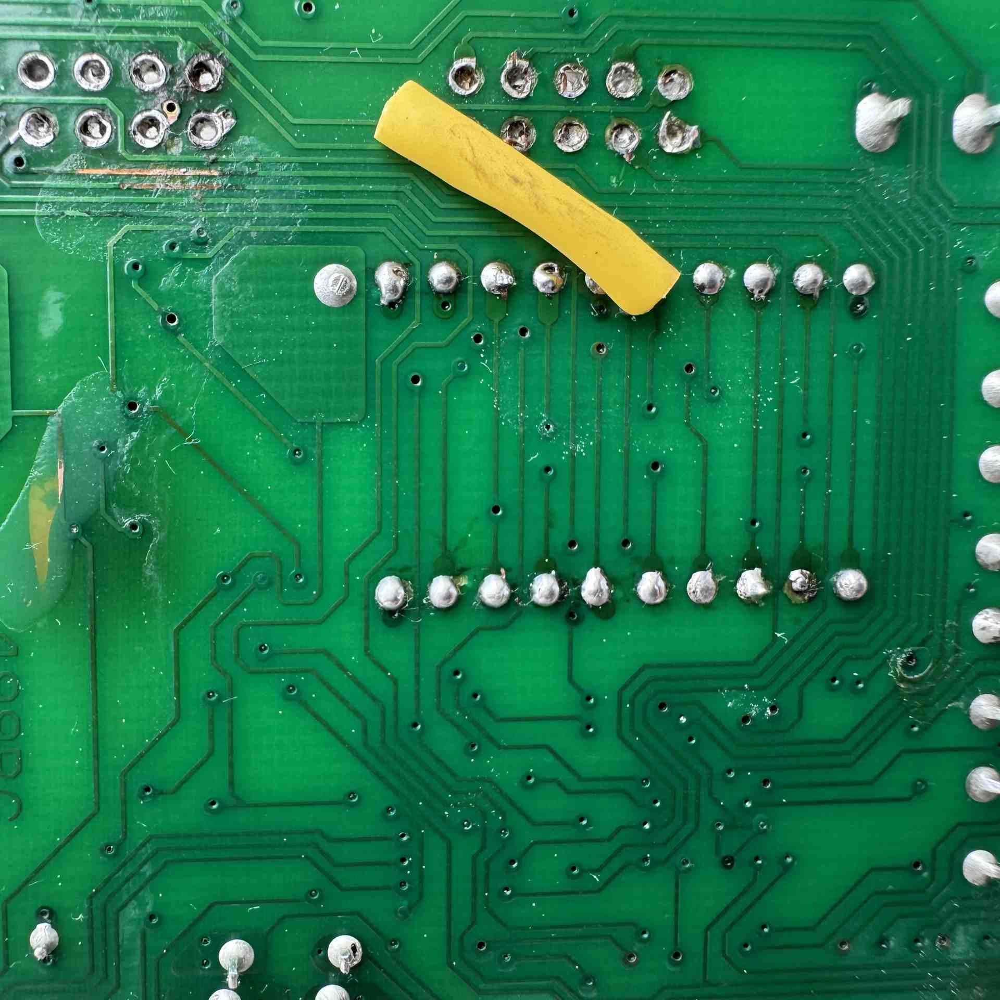

My exterior sliding gate stopped working. The gate is operated by a simple remote controller that allows me to open and close it. One day, the gate simply did not respond to the remote. I could still see the gate light flashing when I tried to open/close it, but the gate itself did not move. This immediately led me to believe that something was wrong—otherwise, the indicator light wouldn’t work either. So I knew it wasn’t related to the remote controller battery or a general power issue.

When I tried to operate the gate, I could still hear the relays clicking inside the motor housing next to it. The first thing that came to mind was that the motor was dead.

The gate opener is a [Proteco](https://www.proteco.net/) unit. I opened the appliance housing and could clearly identify the motor, the PCB, some sensors, wires coming from the ground, and... a fried gecko between the live and neutral wires. The gecko looked like it had been dead for a long time (years, maybe), so I ruled it out as the cause of the problem.

The PCB has a couple of 7-segment displays that show codes whenever the gate is “trying” to operate. I searched online for possible error codes, but everything seemed to be operating normally.

So, the first suspect was the motor itself. I checked the voltage on the PCB connector going to the motor and got around 30 V AC. Something was clearly off. The motor runs on mains voltage (230 V AC in Portugal). I then connected live and neutral directly to the motor, and the gate worked. The problem was not the motor—it had to be somewhere on the PCB.

  
  
  

## Throwing parts at it

A visual inspection of the board revealed some dirty contacts and a few areas where the solder mask was missing, but I could see no broken traces or burned components. I covered those spots with some nail varnish to protect them from corrosion.

I then started hunting down the root cause by working backwards from the motor connector. The connector itself has 3 pins:
 1. Live wire for spinning left (open gate)
 2. Neutral wire
 3. Live wire for spinning right (close gate)

I removed the PCB from the enclosure and took it inside so I could debug the problem more easily.

The PCB layout separates the high-voltage circuit (on the right) from the low-voltage logic and ICs (on the left).

The closest component to the connector was a relay (**HLS8L-DC24V**). I later realized it was just used to select the motor direction, but at the time I didn’t think much about it and replaced it anyway.

No luck.

Poking around with the multimeter, I started doing continuity tests. Right after this relay, and somehow connected to it, was a JW2SN-DC24V, which is a DPDT (Double Pole Double Throw) relay—basically two relays with a single coil that activates both at the same time. I figured out that the neutral and live wires were in different circuits, each connected through this relay. This part was harder to get, and I had to wait around two weeks for it to arrive from China.

Desoldering it was already a challenge since it has 8 through-hole pins, but I managed. I soldered the new one in and assembled everything back together.

Still no luck.

Right above the **JW2SN-DC24V**, there was a **BTB16-600SL**. This is a type of electronic switch called a triac, used to control AC power (like 230 V mains) in things like dimmers, motor controllers, and heaters. In this case, the triac is related to the neutral side of the circuit. Its output is directly connected to the neutral wire going to the motor.

With a bit more live debugging (measuring voltages on the motor connector), I figured out that the problem was related only to the neutral path. Whenever the gate was triggered, I measured ~230 V between the live wires (in the active direction) and the main neutral from the outlet—but not from the neutral on the connector.
So I replaced the **BTB16-600SL** as well.

Again, no luck.

  

## The unlikely culprit

I measured voltages directly on the triac and determined that it wasn’t being activated—there was no signal reaching its gate (G). This meant the issue was likely in the logic side of the circuit.

So I kept going backwards. The gate of the triac was connected to a small IC labeled **ULN2003**. This is a very common chip used to drive higher-current loads from low-power logic signals. Looking at its input pins, I traced one to GND and the other to a resistor right next to the IC. After that resistor, things became a mystery.

Naturally, this signal should come directly from the microcontroller (an **Atmega324P**). I did exhaustive continuity tests but couldn’t find where the signal was coming from. Following the trace from the resistor, I saw it going through several vias from the top to the bottom layer and back again, eventually disappearing under the 7-segment displays.

At that point, I decided to remove both displays since the board wasn’t working anyway. After a long battle with desoldering them, I finally managed to get them off the board. Underneath, I found yet another detour through the bottom layer and back to the top, where I could finally see which pin on the **Atmega324P** it connected to.

So why was the continuity test failing?

I eventually discovered that the trace was broken between two vias. There was no visible damage—it just wasn’t electrically connected anymore.

After all that effort, the fix was simple: a jumper wire between those two vias on the top of the board.

I soldered the 7-segment displays back on (not very confidently, since some copper had lifted during removal). After reassembling everything and reconnecting the motor, the gate worked.

To my surprise, the 7-segment displays were also working.

  
  
  

# Pseudo-schematic of the circuit

This is the schematic I created while reverse engineering the board:

  

## Final thoughts

This was a difficult but very rewarding problem. It took time—especially waiting for replacement parts—and I must have assembled and disassembled the system more than ten times.

**Warning**: Working with mains voltage is dangerous. Whenever I needed to touch or probe the circuit, I always turned off the power at the breaker.

Until next time!

## *Disclaimer*

*I'm a software engineer with no background in electronics. Please don't consider what you read here to be best practice. Use at your own risk.*

*Nevertheless, feedback is always welcome.*
